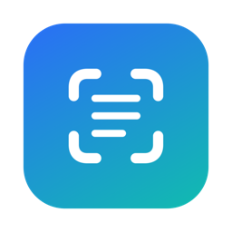
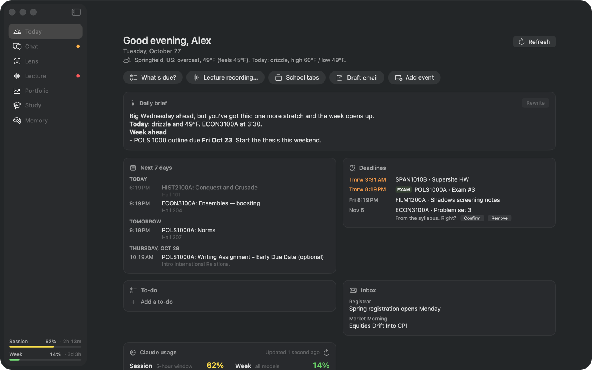
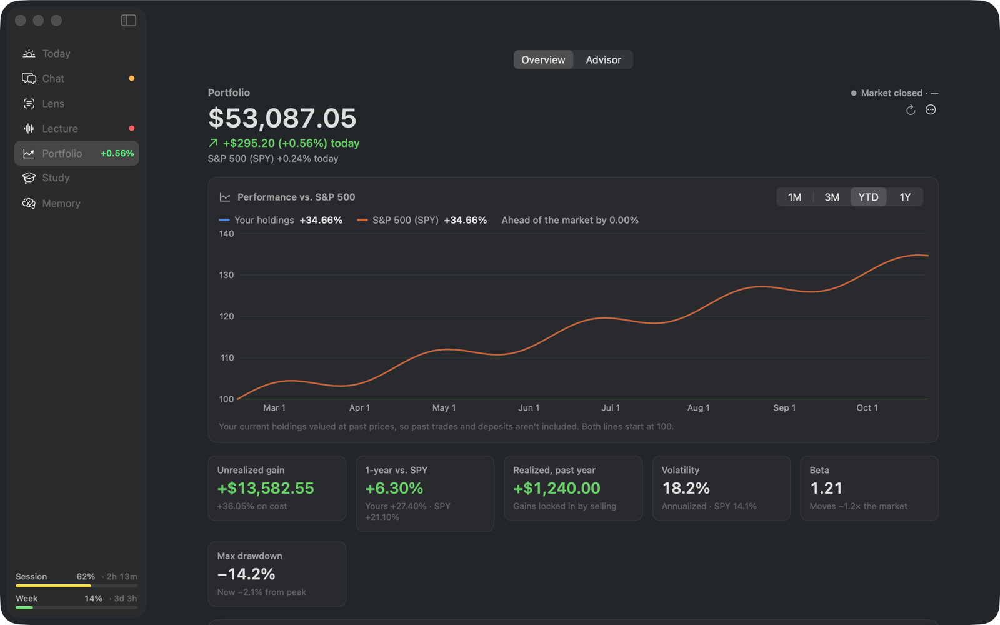
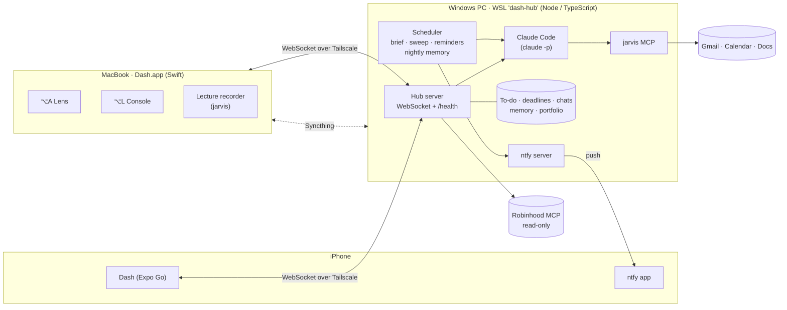

<p align="center">
  
</p>

<h1 align="center">Dash</h1>

<p align="center">
  <strong>A personal AI console for macOS and iPhone, with a lens over any window, a full Claude Code chat, and a secretary that never sleeps.</strong>
</p>

<p align="center">
  
  
  
  
  
  
  
</p>

<p align="center">
  
</p>

> [!NOTE]
> Dash is a personal, single-user system: one Mac, one iPhone, one Google account, one always-on PC. Everything
> personal (your name, school links, addresses) lives in untracked config files described under
> [Configuration](#configuration), so the code itself is a template you can adapt.

## Contents

- [What Dash is](#what-dash-is)
- [Features](#features)
- [Architecture](#architecture)
- [Repository layout](#repository-layout)
- [Getting started](#getting-started)
- [Configuration](#configuration)
- [Using Dash](#using-dash)
- [Security and privacy](#security-and-privacy)
- [Testing](#testing)
- [Further reading](#further-reading)

## What Dash is

Dash is one assistant that follows you across your devices. On the Mac it's a lens you can hold over any window and a
console with your day, your chats and your portfolio. On the iPhone it's the same console in your pocket. Underneath,
an always-on hub keeps everything in one place, remembers what you've talked about, and nudges you before things are
due, even with the laptop closed. Every model call goes through Claude Code on your Claude subscription, so there's no
API key, and the tools that matter (email, calendar, files, the web) are one approval card away.

Dash has a persona, too: a warm, wry chief of staff ("he") who knows your schedule, keeps his own notes on how you two
work, and talks to you like someone who's been paying attention.

## Features

### ⌥A Lens: help with whatever's on screen

Press **⌥A** over the window you're working in, such as a homework site, a PDF or a spreadsheet. Dash captures just
that window, sends it to Claude, and answers in a small floating panel that stays on top without stealing focus.
- **Wand menu:** one-click **Answer**, **Hint**, **Explain** or **Check My Work** on the current capture, plus a Quiz mode.
- **Follow-ups:** keep asking about the capture, or about anything else.
- **Context:** the lens knows your persona and memory, and each answer goes into Dash's memory log.
- **Small footprint:** captures are downscaled to at most 1568 px. **⌥Space** shows or hides the panel, and it
  remembers its size and position.

### ⌥L Console: everything else, in one window

A full window with a sidebar of pages: **Today**, **Chat**, **Lens**, **Lecture**, **Portfolio**, **Study** and
**Memory**. Open it with **⌥L**, the menu bar icon, or the Dock.

### Today: your day at a glance

- **A written daily brief:** an encouraging opener, today's classes and weather, the week ahead, and the small things
  you're likely to forget. Claude writes it, and **Rewrite** asks for another take.
- **The next 7 days** of calendar, grouped by day, with locations.
- **Deadlines** from your calendar, your syllabi and your chats, soonest first, with exams marked. Dates Dash read from
  a syllabus wait for your **Confirm** before they count.
- **A to-do notepad:** a plain markdown checklist that chats can add to. Checked items disappear after a short undo
  window.
- **Inbox and weather,** plus one-tap actions: What's due?, start a lecture recording, open your school tabs, draft an
  email, add an event.
- **Claude usage:** how much of your 5-hour and weekly limits you've used, with reset countdowns. It's also shown at the
  bottom of the sidebar.

### Chat: a full Claude Code session with your tools

Each chat is a real Claude Code session that can read and search files, run shell commands, edit and write files,
search and fetch the web, and hand work to subagents. It also has jarvis's Gmail, Google Calendar and Google Docs tools.
- **Approve/Deny cards:** anything that changes something (sending email, editing a calendar, a shell command that
  writes, a file edit, a web fetch) shows the full command, diff or email first. **Always allow** applies for the rest
  of that chat only. Reads run on their own.
- **Chats persist.** They're saved with titles and history, and resume with their full context after a relaunch, a
  Stop, or a change of model or permissions. **Stop** interrupts without losing the conversation, and messages typed
  while Claude is answering wait in a queue.
- **A composer that respects you:** markdown rendering with copyable code blocks, expandable tool calls, pasted or
  dropped images and files, and `/` to load any installed Claude Code skill. Model, effort and permissions are set per
  chat.
- **Off the record:** a toggle that keeps a conversation out of memory entirely. It's stored apart, never summarized,
  and unreadable by other chats.
- **Check-ins:** the evening check-in opens as a chat, so you can answer it in your own words.

### Lecture: notes that write themselves

Press **Start** for a class, and Dash records the microphone and transcribes it **locally** with faster-whisper, so
audio never leaves the Mac.
- Every 5 minutes, the new transcript becomes clean, topic-organized notes appended to that class's Google Doc.
- **Stop** files the rest, rewrites the whole day's section into a tidy, deduplicated version, and deletes the raw
  transcript.
- The menu bar icon turns red while recording, and you can start or stop from the iPhone's Lecture tab.

### Portfolio: your Robinhood account, analyzed and strictly read-only

Dash connects to Robinhood's official agent MCP server with its own OAuth sign-in. Data flows straight to the app, so
live prices cost no tokens.
- **Live value:** prices update every 15 seconds while the market is open, with the day's change next to the S&P 500.
- **Performance vs. the S&P 500** over 1M, 3M, YTD and 1Y, computed from your current holdings at past daily closes.
  The chart says so.
- **Risk metrics:** unrealized and realized gains, annualized volatility, beta, max drawdown, concentration, sector
  weights, and each holding's share of portfolio variance. There's also a sortable holdings table.
- **The Advisor:** a chat persona modeled on a senior risk manager and equity analyst. It takes a five-year,
  fundamentals-first view, puts capital preservation first, and cross-checks every metric against SEC filings or flags
  it. It asks before any taxable or high-turnover suggestion, and never trades. A goals interview on first use becomes
  an investor profile it reads every time.
- **Read-only by construction:** there's no order, cancel or edit path anywhere. See
  [Security and privacy](#security-and-privacy).

<p align="center">
  
  <br><sub>Portfolio, shown with made-up sample holdings.</sub>
</p>

### Study

Launchers for your Claude Code skills (practice exams, essay outlines and anything else you've installed), plus your
own study apps and school links from [your profile](#configuration).

### Memory: an assistant that actually remembers

Dash keeps one memory, on the hub, shared by the Mac, the phone and every chat:
- **A raw log** of everything: chat summaries written when a conversation goes quiet, lens questions, lectures and pushes.
- **A nightly write-up at 4:15 AM:** a journal entry for the day, **core** facts about you, open **follow-ups**
  ("ask how the exam went"), and **self**, Dash's notes on himself (how you two work, running jokes, opinions he's
  formed). Each rewrite is checked before it replaces the old one, so a bad night can't blank your memory.
- **"Remember…"** lines, kept exactly as you said them.
- **A Memory page** on the Mac and iPhone that shows all of it, with **Forget** on every line. Forgetting also scrubs the
  log and the journal.

### Secretary: nudges that arrive on time

The hub works while your laptop sleeps and pushes to your phone through a self-hosted [ntfy](https://ntfy.sh) server:
- **Deadline reminders** 3 days, 1 day and 3 hours before (exams also get one a week and two days ahead), with a
  **Done** button right on the notification. Several at once arrive as one digest.
- **A morning brief** at 8 AM, a **follow-up** at 12:30, and an **evening check-in** at 9 PM.
- **A look around** twice a day: Dash reads your inbox and calendar for anything that isn't on your lists yet, adds it
  as an unconfirmed deadline or follow-up, and pushes at most once. He never pushes something you've already done.
- **Quiet hours from 11 PM to 8 AM.** Nothing gets through. What was held arrives at 8 as one digest, and anything that
  expired overnight is dropped.

### iPhone app

The same Dash in your pocket, built with Expo and loaded in **Expo Go**, so there's no Xcode build or App Store
provisioning: Today, Chats (with approval cards), Portfolio and the Advisor, Lecture controls, Study, Memory and
Settings. It pairs with a QR code, keeps an offline copy for when you're out of signal, and reconnects on its own.
Because everything lives on the hub, it works with the Mac closed.

## Architecture

Dash's shared half runs on the **Dash hub**: an always-on service in WSL on a Windows PC, reached over Tailscale.
The Mac app and the iPhone app are both clients of it. The ⌥A lens and lecture recording stay on the Mac, which has
the screen and the microphone.



- **Claude runs through Claude Code**, using `claude -p` in headless stream-json mode on the Claude subscription. There's no
  API key. `ANTHROPIC_API_KEY` is stripped from every child environment, so a key set in your shell is never billed.
- **jarvis** is a Python MCP server (`companions/jarvis-mcp`) with 21 tools for Gmail, Calendar, Docs, files, weather,
  web search, a headless browser and lecture recording.
- **Syncthing** keeps Documents, Desktop, Downloads, BrightspaceToDo, `~/.claude/skills` and `~/.dash-shared` (ABOUT_ME)
  the same on the Mac and the hub. Both sides keep 30 days of replaced or deleted files in each folder's `.stversions`
  (Downloads: 14 days). The hub's own data is mirrored back to `~/Dash Backups/hub-data`, with sign-ins and ntfy excluded.
- **While the hub can't be reached**, Today, the to-do list and chats show their last copy read-only. Unpaired,
  Dash runs everything on the Mac.

## Repository layout

| Path | What's there |
|---|---|
| [`Sources/Dash/`](Sources/Dash) | The macOS app (SwiftPM, SwiftUI + AppKit) |
| [`hub/`](hub) | The always-on hub: server, chats, memory, deadlines, notifications, deploy scripts ([README](hub/README.md)) |
| [`mobile/`](mobile) | The iPhone app (Expo / React Native, runs in Expo Go) ([README](mobile/README.md)) |
| [`companions/jarvis-mcp/`](companions/jarvis-mcp) | The jarvis MCP server ([README](companions/jarvis-mcp/README.md)) |
| [`Resources/`](Resources), [`tools/`](tools) | App icon and the script that draws it |
| `build.sh`, `setup.sh` | Build and install the Mac app; set up a new Mac |

<details>
<summary><strong>Mac app code map</strong></summary>

| File | Role |
|---|---|
| `AppDelegate.swift` | Menu bar item, ⌥A / ⌥Space / ⌥L hotkeys, choosing which window to capture |
| `ScreenCapture.swift` | Captures the frontmost window with ScreenCaptureKit and downscales it to ≤1568 px |
| `ClaudeCLI.swift` | One `claude -p` session per conversation. A `ClaudeProfile` sets its tools; calls that aren't pre-approved come back as permission requests for Dash to answer |
| `JarvisClient.swift` | Dash's own jarvis MCP process, called directly over stdio |
| `Personal.swift` | ABOUT_ME, the memory file, and skill loading for console prompts |
| `Prompts.swift` | Lens, console, daily brief and lecture-notes prompts |
| `Usage.swift` | Subscription usage, read from the `rate_limit_event` Claude Code sends with every request |
| `Conversation.swift`, `Session.swift` | A conversation's turns, streaming, tool chips and approvals; the ⌥A lens session |
| `Console/` | The console window and pages: `ChatModel` (saved chats, resume, queue, settings), `TodayModel`, `LectureController`, `MemoryModel` / `MemoryPage`, `Deadlines`, `ToDoList`, and `Toolbox` (the Study buttons) |
| `Hub/` | `HubClient` (pairing, sign-in, reconnect with backoff, heartbeat), `HubConversation`, `HubSettings`, `LectureRemote`, `HubClientCheck` |
| `Portfolio/` | `RobinhoodClient` (OAuth + read-only MCP), `RobinhoodRelay` (read-only MCP for the advisor), `PortfolioModel`, `Analytics`, `PortfolioView` |
| `OverlayPanel.swift`, `OverlayView.swift`, `SettingsView.swift` | The floating panel and Settings |

</details>

## Getting started

### Requirements

- macOS 14 or later, with Xcode Command Line Tools. Xcode itself isn't needed.
- [Claude Code](https://claude.com/claude-code), signed in once by running `claude` in Terminal.
- Python 3.12, for jarvis. For the hub: a Windows PC with WSL2, plus [Tailscale](https://tailscale.com) on every device.

### Mac app

```sh
git clone <this repo> ~/Dash && cd ~/Dash
./setup.sh                 # first time on a new Mac
./build.sh --install       # every build after that
open ~/Applications/Dash.app
```

`setup.sh` installs what Dash needs outside this folder, from `companions/`:
- jarvis, into `~/.claude/mcp-servers/jarvis-mcp`, with its own venv, registered with Claude Code
- any Claude Code skills you put in `companions/skills/` (git-ignored), into `~/.claude/skills`, keeping any that are
  already there. The Study page and `/` in chats list whatever skills are installed.

It then runs `build.sh --install`, and finishes by printing the manual steps.

Secrets are never in the repo:
- the Google credentials and token (`~/.jarvis`)
- the Robinhood login (Keychain)
- `~/ABOUT_ME.md`
- Dash's memory

`build.sh --install` quits a running Dash the way ⌘Q does, so it asks first if a lecture is recording.

### The hub and the phone

The hub's setup, from a bare Windows PC to `deploy.sh`, is in [`hub/README.md`](hub/README.md). The iPhone app's is in
[`mobile/README.md`](mobile/README.md). Once the hub is running, pair this Mac in **Settings › Dash hub**.

### Permissions and signing

- **Microphone:** asked for at the first lecture recording.
- **Screen Recording:** asked for at the first capture (System Settings › Privacy & Security › Screen & System Audio Recording).
- `build.sh` signs with the "Dash Local Signing" certificate in your login keychain, so these permissions survive rebuilds.
  Without that certificate it falls back to ad-hoc signing, and macOS asks again after each build.

## Configuration

Nothing personal is committed. Dash reads it from these untracked files:

| File | Where | Holds |
|---|---|---|
| `~/.dash-shared/profile.json` | Mac (synced to the hub) | Your name, time zone, a crisis-support line, school links and study apps. Every field is optional. |
| `~/ABOUT_ME.md` | Mac (synced to the hub) | Who you are, courses, schedule and writing voice. Injected into every prompt. |
| `~/.config/dash/hub.env` | Hub | `DASH_ALERT_EMAIL` (health alerts) and `DASH_PUBLIC_URL` (your `https://dash-hub.<tailnet>.ts.net`) |
| `build.local` | Repo root (git-ignored) | `DASH_BUNDLE_ID`, your app's bundle identifier (default `com.example.dash`) |

```json
{
  "name": "Alex",
  "fullName": "Alex Doe",
  "timezone": "Eastern",
  "crisisHelp": "your school's counseling center",
  "links": [{ "title": "School email", "subtitle": "Outlook", "icon": "envelope", "url": "https://…" }],
  "studyApps": [{ "title": "Vocab drill", "subtitle": "Spanish", "icon": "character.book.closed", "url": "https://…" }]
}
```

`icon` is an [SF Symbol](https://developer.apple.com/sf-symbols/) name. A study app can use `"file": "~/path/index.html"`
instead of `url`. Secrets (Google and Robinhood sign-ins, device tokens) are created at runtime and never leave the
machine they belong to.

## Using Dash

| Shortcut / control | Does |
|---|---|
| **⌥A** (or the camera button) | Capture the window you're in and answer it |
| **⌥Space** (or ×) | Show or hide the panel |
| **⌥L** (or the window button, or the menu bar icon) | Open or hide the console |
| **Wand button** | Answer, Hint, Explain, or Check My Work on the current capture |
| **Chat field** | Follow-ups about the capture, or anything at all if nothing's captured |
| **Gear** (or ⌘, / menu bar icon) | Settings: model, opacity, the Dash hub |

- The panel stays on top without taking keyboard focus, so you keep typing in your app until you click its chat field.
- Drag the top bar to move the panel and the bottom-right grip to resize it. Its frame is remembered. Right-click the
  top bar, or use Settings › Reset Panel Position, if it ends up off-screen.
- Clicking the Dock icon, or tabbing to Dash, brings the console back. Quit with ⌘Q or the menu bar item.
- **Settings › Dash hub › Open Dash at login** starts Dash when you log in. Quitting mid-lecture asks first.
- Events are logged to `~/Library/Application Support/Dash/dash.log`.

Each console session also gets:
- `~/ABOUT_ME.md`
- Dash's memory: from the hub when paired, otherwise `~/Library/Application Support/Dash/memory.md`. Lines saved
  there while unpaired go to the hub on the next pairing.

Files made with the Study skills go in `~/Documents/Dash`.

Dash keeps its own jarvis process running for Today and Lecture. Recording lives inside that process, so keep Dash
open while a lecture records.

## Security and privacy

- **Robinhood is read-only, in four independent layers:**
  - `RobinhoodClient.call` refuses every tool that isn't on its read-only allowlist (and doesn't start with `get_`),
    before any request is made.
  - The advisor reaches Robinhood through `RobinhoodRelay`, a local MCP server on 127.0.0.1 with a per-launch secret.
    It offers Claude only those read tools, and the Robinhood login never leaves the app.
  - The data loop never goes through Claude, so live prices cost no tokens.
  - There's no order, cancel or edit path, even with Approve or bypassPermissions. (Robinhood's server can trade,
    but only in its separate Agentic account.)
  - Robinhood has no portfolio-history tool, so performance values today's holdings at past daily closes, and the
    chart says so.
- **Chats can't read secrets.** Every Claude session on the hub runs with `Read(//…)` deny rules for its secrets,
  ntfy, the paired-device list, off-the-record chats, `~/.jarvis` and `~/.claude` (except skills). The advisor may
  fetch only `sec.gov`. jarvis's `file_read`/`file_write` refuse the same places, plus key and `.env` files.
- **Off the record means off the record.** Those chats are stored apart, are never summarized, and stay out of memory.
- **The network is tailnet-only.** The hub and ntfy bind to loopback and are published with `tailscale serve`, with no
  funnel. Devices pair with one-time 6-digit codes, and their tokens are stored as hashes.
- **The Claude subscription, not an API key.** API keys are stripped from every child process.

## Testing

```sh
cd hub && npm run check && npm run selftest && npm run portfoliotest   # hub: types + every check, in a throwaway data folder
cd mobile && npx tsc --noEmit                                         # phone app types
swift build                                                           # Mac app
```

The hub's tests never touch the real Documents, ABOUT_ME or memory. `DASH_DATA` moves those paths into a temporary folder.

<details>
<summary><strong>Mac app test hooks</strong></summary>

Run these with the debug binary, and set `DASH_SUPPORT` (plus `DASH_HUB_CREDENTIALS` and `DASH_HUB_CACHE`) to temp
paths, so tests never share the installed app's files.

```sh
Dash --preview out.png [today|chat|lens|lecture|portfolio|portfolio-advisor|study]  # screenshot a console page with sample data
Dash --preview out.png [portfolio-sample|portfolio-sample-bottom]                  # Portfolio with made-up holdings
DASH_PREVIEW_SIZE=720x480 Dash --preview out.png today  # another window size; also prints the page's minimum width
Dash --preview out.png [panel-chat|long|settings]       # the floating panel
Dash --chat-selftest                                    # drives the real chat on Haiku: stop, resume, queue, approvals, history
Dash --jarvis calendar_get '{"days":3}'                 # call a jarvis tool through Dash's client
Dash --ask --console "what's due this week?"            # console chat from the CLI (denies all writes)
Dash --today                                            # load Today for real and write the brief
Dash --hub-pair wss://… 123456                          # pair with a hub (DASH_HUB_CREDENTIALS=file keeps it out of the Keychain)
Dash --hub-import file.json                             # move such a pairing into the Keychain (installed binary)
Dash --hub-check                                        # sign in, load Today, round-trip a to-do through the hub
Dash --hub-memory-check                                 # queue hundreds of memory entries and check each arrives once
Dash --hub-chat-check                                   # drive the Chat page through a (throwaway) hub on Haiku
Dash --robinhood tools|connect|call <tool> '{json}'     # Robinhood client (run the installed app's binary)
Dash --portfolio [advise "question"]                    # analytics self-test + live stats (+ ask the advisor)
Dash --relay-check                                      # relay refuses strangers, lists only reads, blocks orders
```

</details>

## License

[MIT](LICENSE).

## Further reading

- [`hub/README.md`](hub/README.md): memory, deadlines, notifications, the protocol, deploying and operating the hub
- [`mobile/README.md`](mobile/README.md): the iPhone app
- [`companions/jarvis-mcp/README.md`](companions/jarvis-mcp/README.md): jarvis's tools and setup
