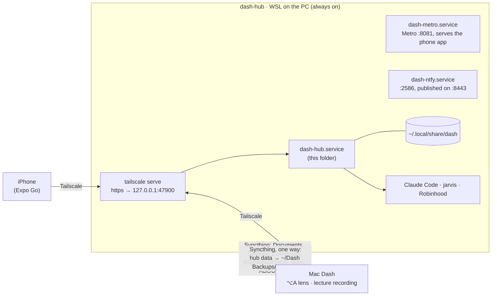

# Dash hub

Dash's always-on half. It runs in WSL (Ubuntu) on a Windows PC as the Tailscale machine `dash-hub`, so the phone
works with the MacBook closed. The hub owns everything Dash shares:
- the to-do list, Today and the daily brief
- chats and the Portfolio advisor
- Robinhood and usage
- memory and deadlines
- the paired devices

Mac Dash and the iPhone app are both clients of it.



Lecture recording needs the Mac's microphone, so the hub only relays the phone's Start/Stop to the Mac.

## Memory

Memory lives in `~/.local/share/dash/memory`. Chats, the brief and the lens all get it in their prompts, and chats can
Grep the whole folder. Days start at 4 AM, so a late night counts as the evening before.

| File | What it holds |
|---|---|
| `log/<day>.jsonl` | Everything, append-only: chat summaries (Haiku, when a chat goes quiet), lens questions and lectures from the Mac, and pushes |
| `journal/<day>.md` | One entry per day, written at 4:15 AM |
| `core.md` | Long-lasting facts about the user, rewritten nightly by Sonnet |
| `threads.md` | Follow-ups ("after 2026-11-02 · ask how the exam went") |
| `self.md` | Dash, in his own words: how he and the user work, running jokes, opinions he's formed |
| `remember.md` | The "remember…" lines, exactly as asked |

How the nightly write-up protects memory:
- Each rewrite is checked before it replaces a file, and a file edited meanwhile keeps the edit.
- The journal, which marks the day done, is written last.
- Quiet days get only a short Haiku journal.
- A real failure shows up in health.

**Off-the-record** chats live in `chats/off-record/`. No other chat, the sweep or the advisor can read them, and they're
never summarized, even after the toggle is turned off.

## Deadlines

Deadlines are kept in `deadlines.md`. They come from three places:

| Source | How |
|---|---|
| Google Calendar | Every 3 hours, Haiku sorts new events into exam / due / class. A moved event updates its deadline; a cancelled one removes it. |
| `~/Documents/Syllabi` | When a file is new or changed, Sonnet reads it. The dates wait for a Confirm. |
| Chats | "Add the ECON memo for Friday" |

## Notifications

Pushes go through a self-hosted [ntfy](https://ntfy.sh):
- It runs as `dash-ntfy.service` on 127.0.0.1:2586, published by `tailscale serve` on :8443.
- The phone's ntfy app subscribes to the topic in `secrets/ntfy.json`, which the phone app's Settings shows.

| Push | When |
|---|---|
| Deadline reminders | 3 days and 1 day before (9 AM), and 3 hours before. Exams also get one a week and 2 days before. |
| Morning brief | 8:00 AM, only if the brief was written |
| Follow-up | 12:30 PM |
| Check-in | 9:00 PM |
| Dash's own look around | 8 AM and 4 PM. At most one push each, and never something already on the lists. |

- **Quiet hours are 11 PM to 8 AM, and nothing gets through them**, urgent reminders included. What was held goes out at
  8 as one digest, and anything already past by then is dropped.
- Several reminders due at once also go out as one push.
- A reminder's **Done** button POSTs `/action/done` with a key signed by the hub.

**Schedule:** `src/scheduler.ts` keeps each job's last successful run in `scheduler.json`, so a restart neither repeats a
job nor skips one. A failed run is retried once. The model jobs (brief, sweeps, consolidation, syllabi) run one at a time.

## Protocol

One JSON message per WebSocket frame:

```jsonc
{"id": 7, "type": "todo.add", "text": "…"}           // request
{"re": 7, "ok": true, "result": {…}}                 // reply
{"re": 7, "ok": false, "error": "…", "code": "…"}    // refusal; code "unknown_token" means "pair again"
{"event": "todo", "data": {…}}                       // pushed event
```

- A connection signs in first with `pair` (a 6-digit code) or `hello` (a saved token).
- A pairing code carries its role: `npm run pair` makes one for a Mac, and `npm run pair -- phone` one for a phone.
- Request parameters can't be called `id`, since that's the request's own id.
- `ping` returns `{}`. The hub also sends ws pings, and drops a client that misses two.

| Events | |
|---|---|
| `today`, `todo`, `deadlines`, `usage`, `chats`, `lecture`, `portfolio`, `health` | To every signed-in app (`portfolio` only while it's on screen) |
| `chat` | A chat's last two turns and state, to apps that opened that chat (the advisor goes to all) |
| `devices` | Macs only |
| `command` | To the recording Mac |

Memory is fetched on request: `memory.get`, `memory.forget`, `memory.log`, `memory.context`.

## Running it

Node runs the TypeScript directly, with no build step:
- On the hub, systemd user services keep it up.
- Ubuntu itself is kept running from boot by the "Dash Hub" scheduled task (`deploy/setup-windows.ps1`).
- Syncthing's ignore lists and versioning are in `deploy/syncthing/`. `setup-syncthing.sh` applies them to both sides.

```sh
hub/deploy/deploy.sh                              # from the Mac: test, ship the committed HEAD, test on the hub, swap in, restart
ssh dash-hub 'cd ~/Dash/hub && npm run pair'      # a pairing code (normally: Mac Dash › Settings › Dash hub › Pair a Phone…)
curl https://dash-hub.<tailnet>.ts.net/health     # what's working, and the deployed version
```

`deploy.sh`:
- refuses uncommitted changes
- runs the tests on the Mac, then copies the committed code (hub, phone app, jarvis) to `~/Dash.new` on the hub
- runs the self-test again on the hub's own Node
- only then swaps it in and restarts

The previous version stays in `~/Dash.prev`, and every deploy is logged to `~/Dash-deploys.log`.

### Setting up a new PC

| Step | Where | Run |
|---|---|---|
| 1 | Admin PowerShell | `deploy/setup-windows.ps1`: WSL and Ubuntu, no sleep, and the "Dash Hub" scheduled task |
| 2 | Ubuntu, as root | `deploy/setup-wsl.sh`: systemd, and Tailscale as `dash-hub` with Tailscale SSH |
| 3 | The Mac | `deploy/deploy.sh --setup`: Node 24, Syncthing, Claude Code and jarvis |
| 4 | The Mac | `deploy/deploy.sh` |

## Tests

```sh
npm run check          # TypeScript
npm run selftest       # selftest.ts + src/test/*.test.ts: pairing, Today, to-do, lecture relay, chats, memory,
                       # deadlines, reminders, pushes, heartbeat (throwaway hub, fakes; never the real Documents)
npm run portfoliotest  # read-only rules, relay refusals, portfolio math (fake Robinhood)
npm run chattest       # real chats on Haiku: reply, Deny/Approve, Stop, resume, queue, retry, memory across chats
```

## Code map

| File | Role |
|---|---|
| `src/main.ts` | Wires it all together, and the schedule |
| `src/server.ts` | WebSocket server, requests, coalesced events, heartbeat, the lecture relay, `/health` |
| `src/devices.ts` | Pairing codes (with their role) and device tokens. Only hashes are saved. |
| `src/today.ts`, `src/todo.ts`, `src/usage.ts` | Today and the brief, the to-do list, subscription usage |
| `src/chats.ts` | Chats and the advisor: Claude Code sessions, approvals, Stop, queue, resume, saved history, off-the-record |
| `src/claude.ts`, `src/jarvis.ts` | Claude Code (stream-json, deny rules, timeouts, per-call usage log) and jarvis (MCP over stdio) |
| `src/portfolio/` | The read-only Robinhood client, the advisor's relay, the model and the analytics |
| `src/health.ts` | Checks sign-ins, services and the nightly memory job every 15 minutes. Shows a banner on Today and sends a daily email. |
| `src/memory.ts`, `src/consolidate.ts` | Dash's memory and the nightly write-up |
| `src/deadlines.ts`, `src/proactive.ts`, `src/notify.ts`, `src/scheduler.ts` | Deadlines, the secretary jobs, ntfy with quiet hours, the clock |
| `prompts/` | Persona, console, brief, check-in, lens, advisor, and the summary / consolidation / calendar / syllabus / push / sweep helpers |
| `deploy/` | `deploy.sh`, the systemd units, the Windows and WSL setup scripts, ntfy setup, and `syncthing/` |
